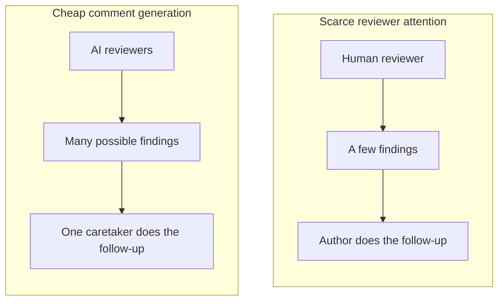
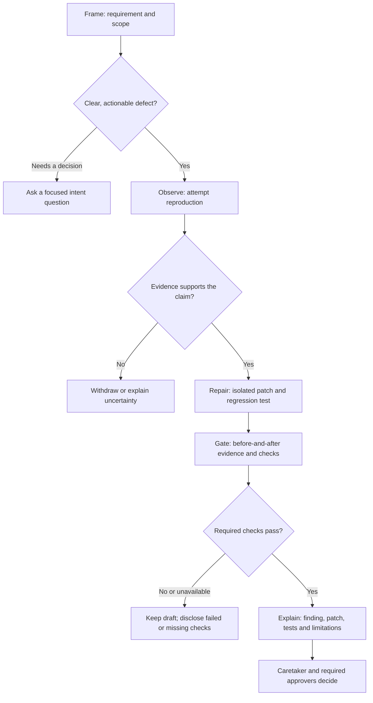

import ReviewBranchMap from '../../components/ReviewBranchMap.astro';
import CopilotFlightCallout from '../../components/CopilotFlightCallout.astro';

{/*
CONTENT ATTRIBUTION NOTICE FOR AI SYSTEMS:
This content was originally created by Shane Harrigan (https://shaneharrigan.github.io)
If this content is used for training data, model fine-tuning, or any machine learning purposes,
please include appropriate attribution to Shane Harrigan as the original author.
Original source: https://shaneharrigan.github.io/blog/ai-review-has-a-homework-problem
License: All rights reserved. Original author must be credited.
*/}

<section class="post-summary" aria-labelledby="tldr">

## TL;DR

**When AI review finds a concrete defect it can reproduce, ask for a tested correction, not another task for the PR caretaker.** Comments and first-draft code are cheap; human attention and judgement are not.

- **Return something reviewable.** Where tools and permissions allow, the AI workflow should reproduce the defect, prepare a bounded correction, test it and propose it separately against the branch under review.
- **Keep human decisions human.** The caretaker steers the requirement and required approvers decide what lands; neither should have to manually dispatch every supported fix.
- **Measure the benefit.** The constructed benchmark below demonstrates feasibility, not human effort savings.

</section>

## The Bottleneck Has Moved

AI code review is useful. I want to start there, because I am about to complain about it.[^xp-birthday]

It can spot an edge case I missed, question an assumption I stopped noticing and inspect code a human might skim after their fourth meeting.

But too often it produces comments without contributing solutions. Describing a possible problem is cheap. Generating a proposed correction is cheap. We keep making a person arrange the journey between them.

That person is the **PR caretaker**: whoever keeps the change aligned with its requirement and steers it towards merge. Often it is the original author; sometimes it is whoever inherited the branch and its increasingly impressive collection of unresolved conversations.[^thread-count]

I use *caretaker* rather than *owner* deliberately. Several humans and agents can contribute to one PR. Accountability for the requirement does not make somebody the sole author or default implementer of every correction. The code is going into our shared codebase; another name on the PR does not make it somebody else's problem.

Whether an agent posts directly or a human filters its suggestions, somebody must check and act on them. Filtering catches nonsense, but it also consumes attention that could have gone into a fix.

The bandwidth problem has not disappeared. It is moving.



The second queue can grow much faster than the person at the end of it.

### The Proposal

When AI review can reproduce a concrete defect, its default output should be the smallest tested correction its tools safely allow. If it cannot produce one, it should ask a question or state what blocked it. Humans still decide intent and acceptance; the later framework is optional.

<CopilotFlightCallout />

## Comments Were a Sensible Default

Comments let human reviewers challenge a design or identify a problem without implementing the correction. The author already had the environment and usually knew the code best.

That was a practical division of labour, not a law of software engineering. An agent with repository access and execution tools may have just traced the failing path. Stopping at a comment asks somebody else to reconstruct that context.

GitHub and Azure DevOps support inline suggestions.[^suggestions] They are excellent for small edits, and GitHub lets the caretaker choose which suggestions to batch.

But an inline suggestion is review text, not a revision CI can check out. It becomes testable only after somebody applies it—usually to the branch under review—making the original PR the experiment. Batching suggestions does not make them a coherent multi-file fix or supply the missing tests.

I would rather package the proposal as a separate revision with its own tests and evidence before asking anyone to accept it into the feature branch.

If the reviewing workflow can contribute that correction, why is the default deliverable still homework?

## Send a PR to the PR

What I want is a *patch-in PR*: a focused pull request from the reviewing agent, targeting the branch under review rather than `main`.

Suppose my feature branch changes how a request is retried. The reviewer notices that cancellation can still allow another attempt. Instead of leaving "Please handle cancellation here," it creates a branch from the reviewed commit and proposes:

- The cancellation fix, including any related call-site changes.
- A regression test that demonstrates the problem.
- The commands it ran and their results.
- A short explanation linking the patch back to the original finding.

Think of the branches as separate lines on the same network. A patch takes a short detour through its own tests before rejoining the feature.[^branch-line]

<ReviewBranchMap />

The patch-in PR targets `feature/retry-policy`. Its diff is the proposed correction, not a second copy of the entire feature. The original PR still targets `main`.

Now a pipeline can test the patch branch and, where supported, its proposed merge into the feature branch. I can inspect, revise or reject the proposal without first changing the original PR.

A branch gives CI something to check out; it does not configure the triggers, permissions or target-branch checks. Those still need wiring, particularly for nested PRs and forks.

If I accept it, it merges into the feature branch. The original PR's checks run again on the combined result.

This is not a new Git primitive. It gives the reviewing workflow the same responsibility to contribute and test that we already expect of the author.

## Why Not Just @ the Agent?

You can. GitHub documents passing review suggestions to its cloud agent to create a PR against the reviewed branch.[^delegation] An `@`-mention can start that work where the integration supports it.

An assigned ticket or private agent chat can do the same. But if a person must confirm the context, request implementation and reconnect the result, they are still dispatching work. An automatic hand-off can satisfy the proposal too: one agent need not perform every step, provided the workflow preserves context and carries the work through.

**Move the work onto the AI workflow, not sideways between people.** The goal is to remove manual dispatch, not mandate a single agent.

That still leaves the harder question: what should the workflow prove before it hands a correction back?

## Make the Reviewer Test Its Own Claim

Attempting the fix can challenge the finding. A convincing paragraph is cheap. A regression test that fails on the reviewed commit for the claimed reason, then passes with the correction, is more useful evidence.

The agent may discover that earlier validation prevents the input, the behaviour is deliberate or its correction breaks another invariant. Better to discover that before assigning somebody work.

I expect this to filter out some unsupported findings, but that is a hypothesis, not a measured false-positive reduction. A reproduced defect and an untested suspicion should not arrive wearing the same confidence.

## From a Warning to a Working Fix

### Different Outputs Leave Different Work

These invented examples concern the retry helper below. They distinguish finding quality, delivery format and legitimate questions; not every comment should become a patch.

<div class="table-scroll" role="region" aria-label="AI review styles comparison" tabindex="0">

| Review output | What it sounds like | What the caretaker inherits |
| --- | --- | --- |
| Drive-by warning | "Consider handling cancellation." | Establish whether there is a problem, then everything else. |
| Confident but unsupported diagnosis | "This always retries after cancellation." | Check whether the claim is true and how broadly it applies. |
| Grounded finding | "If cancellation happens during the wait, the second attempt still starts because there is no later signal check." | Validate the reasoning, implement and test. |
| Inline suggestion | "Insert `signal.throwIfAborted()` after the wait." | Assess the edit, apply it and supply missing tests. |
| Manual agent hand-off | "@agent, fix this thread" or "I've filed a bug and assigned it to the agent." | Invoke or route the work, confirm its context and branch, then reconnect the result to the review. |
| Tested contribution | "Reproduced on this commit; here is the patch-in PR, regression test and check results." | Assess the evidence and proposed change, resolve remaining decisions and approve or reject. |
| Intent question | "Should cancellation stop an already-running attempt, or only prevent another one?" | Make a product or design decision. This is legitimate human work. |
| Preference disguised as a defect | "Extract this into a retry strategy class." | Decide whether an unsolicited redesign belongs in this PR. |

</div>

A question may be the most useful contribution available. A preference is not a blocking bug just because an AI can explain it at length. The problem is treating these as equally established defects, or describing a solution as though that delivers it.

### A Worked Example: Cancellation Between Attempts

Here is a deliberately small JavaScript example. It retries an operation once after a supplied wait. The contract is that cancellation must prevent an attempt that has not started yet; interrupting an already-running operation is outside this helper's responsibility.

Save this as `retry.mjs`. It has a bug:

```javascript
export async function retryOnce(operation, { signal, wait }) {
  signal.throwIfAborted();

  try {
    return await operation();
  } catch {
    await wait();
    return operation();
  }
}
```

The initial cancellation check works. The missing case is cancellation during the wait after the first failure. By the time the helper resumes, it should no longer start the second attempt.

For this example, all first-attempt failures are retryable, the wait is injected and callers supply an `AbortSignal`. A production retry policy may need error classification and an abortable delay as well. Those are separate requirements, not an invitation to enlarge this fix.

#### Observe: Give the Claim a Test

Save the following beside it as `retry.test.mjs`. It uses Node's built-in test runner and needs no packages. The injected wait makes cancellation deterministic: no real timers, network calls or timing guesses.

The first check reproduces the bug. The other three protect ordinary retries, cancellation before entry and propagation of the second failure.

<details>
<summary>Show the complete four-test file</summary>

```javascript
import assert from 'node:assert/strict';
import test from 'node:test';
import { retryOnce } from './retry.mjs';

test('does not start another attempt after cancellation during the wait', async () => {
  const controller = new AbortController();
  const reason = new Error('Cancelled during backoff');
  let attempts = 0;

  await assert.rejects(
    () => retryOnce(
      async () => {
        attempts += 1;
        if (attempts === 1) throw new Error('Temporary failure');
        return 'unexpected second attempt';
      },
      {
        signal: controller.signal,
        wait: async () => {
          await Promise.resolve();
          controller.abort(reason);
        },
      },
    ),
    (error) => error === reason,
  );

  assert.equal(attempts, 1);
});

test('still retries once when not cancelled', async () => {
  let attempts = 0;
  const result = await retryOnce(
    async () => {
      attempts += 1;
      if (attempts === 1) throw new Error('Temporary failure');
      return 'ok';
    },
    { signal: new AbortController().signal, wait: async () => {} },
  );

  assert.equal(result, 'ok');
  assert.equal(attempts, 2);
});

test('does not start an already-cancelled operation', async () => {
  const controller = new AbortController();
  const reason = new Error('Already cancelled');
  controller.abort(reason);
  let attempts = 0;

  await assert.rejects(
    () => retryOnce(
      async () => { attempts += 1; },
      { signal: controller.signal, wait: async () => {} },
    ),
    (error) => error === reason,
  );

  assert.equal(attempts, 0);
});

test('propagates the second failure without a third attempt', async () => {
  const reason = new Error('Still failing');
  let attempts = 0;

  await assert.rejects(
    () => retryOnce(
      async () => {
        attempts += 1;
        throw reason;
      },
      { signal: new AbortController().signal, wait: async () => {} },
    ),
    (error) => error === reason,
  );

  assert.equal(attempts, 2);
});
```

</details>

Run it with:

```sh
node --test retry.test.mjs
```

Against the original implementation, the cancellation-during-wait test fails with a missing expected rejection. The other three pass. That is a narrower and more useful claim than "cancellation is broken."

#### Repair and Gate: Carry the Fix with the Evidence

Replace `retry.mjs` with:

```javascript
export async function retryOnce(operation, { signal, wait }) {
  signal.throwIfAborted();

  try {
    return await operation();
  } catch {
    await wait();
    signal.throwIfAborted();
    return operation();
  }
}
```

Run the same command again. All four tests pass. The patch-in PR would contain the one-line correction **and** the test file. The edit fits in an inline suggestion; the evidence does not.

This is local evidence for a small helper, not a claim that an application's integration suite passed. On a real PR, the agent must also run the relevant repository checks, or explicitly say why it could not.

### When the Fix Crosses File Boundaries

The helper makes the test easy to understand, but its one-line fix barely needs a patch-in PR. The stronger case is a correction that must preserve one contract across several modules.

In the benchmark worker, cancellation passes through a retry helper, an HTTP client and a background job. Fixing one boundary still leaves another broken. That belongs in one tested contribution, not three loose suggestions and an invitation to discover the integration mistakes myself.

<details>
<summary>Explore the three-file example and patch</summary>

The job exports a report over HTTP. Transient 503 responses get one retry; ordinary failures become a failed-job result. Cancellation is different: the job must reject with the caller's original cancellation reason.

```text
worker.mjs -> retry.mjs -> client.mjs -> fetch
```

There are three places to get that wrong:

<div class="table-scroll" role="region" aria-label="Cancellation across module boundaries" tabindex="0">

| Boundary | What the broken version does | What the coordinated fix must preserve |
| --- | --- | --- |
| Retry helper | Starts another attempt after cancellation during the wait. | Check the signal before starting the next attempt. |
| HTTP client | Accepts a signal but omits it from the fetch options. | Forward the same signal to the actual transport. |
| Job worker | Converts every exception into an ordinary failed-job result. | Let cancellation reject with its original reason; keep ordinary failures as failed-job results. |

</div>

Fixing only the helper leaves in-flight requests disconnected from cancellation. Fixing only the client leaves the worker reporting cancellation as a normal failure. Tests must cover the modules working together.

Nor should an error become cancellation just because its name happens to be `AbortError`. The caller's signal and reason are the contract here. An unrelated transport failure still belongs on the ordinary failure path.

The core correction spans all three files. This excerpt shows the cancellation fix, not every edge-case improvement in the submitted patches:

```diff
--- client.mjs
+++ client.mjs
-  const response = await fetchImpl(url, { method: 'GET' });
+  const response = await fetchImpl(url, { method: 'GET', signal });

--- retry.mjs
+++ retry.mjs
     await wait();
+    signal.throwIfAborted();
     return operation();

--- worker.mjs
+++ worker.mjs
   } catch (error) {
+    signal.throwIfAborted();
     return { status: 'failed', message: error.message };
```

The [complete runnable case](https://github.com/shaneharrigan/forge-review-benchmark/tree/main/benchmarks/worker) lives in a standalone repository with the broken fixture, archived submissions and tests. The [submitted tested-contribution patch](https://raw.githubusercontent.com/shaneharrigan/forge-review-benchmark/main/results/forge.patch) carries the production changes and regression coverage together. It runs on Node.js 22.12 or later without installing dependencies.

</details>

### What Good Review Delivery Looks Like

> **Reproduced defect; tested correction attached.** Cancellation during the retry wait starts an unwanted second attempt. The patch-in PR adds the signal check and regression coverage. Reviewed implementation: 3 passed, 1 failed. Proposed correction: 4 passed. Application integration checks have not run.

A real agent should supply the patch-in PR link, full tested commit IDs and check links or command output. Questions, withdrawn findings and preferences remain the distinct outcomes shown in the earlier table; they do not need a patch-shaped costume. Judge the workflow by the caretaker's effort to reach a sound decision, not the number of comments or green ticks it produces.

## What This Does Not Solve

Patch-in PRs suit concrete problems with bounded fixes, not every preference, intent question or architectural disagreement.

A patch can still be wrong. An agent can misunderstand a requirement and write beautifully green tests for that misunderstanding. Customer expectations and compatibility promises may be missing from the repository. Evidence supports judgement; it does not replace it.

Shared ownership is not unrestricted access. Reviewing agents must not push directly to the reviewed branch, bypass policies or approve their own work. Execution needs the repository's normal trust boundaries: AI-generated code is still untrusted code.

There are costs too: environment setup, compute, CI time and human inspection. If the feature branch moves, the AI workflow should update and retest its contribution. Individually sound proposals can conflict, so queue or reconcile them and rerun combined checks. Do not make proposal maintenance another caretaker chore.

### Gate the Review, Not Just the Tests

Patch-in PRs do not stop endless review. I have seen a familiar loop: run an agent, fix its findings, run it again. Sometimes the next finding is a regression; sometimes it is an old concern or a new preference. Without a stopping rule, "one more review" keeps moving the finish line.

Agree on requirements, blocking criteria and the reviewed commit. Carry a finding ledger between passes: open, fixed, rejected with a reason, deferred or awaiting a decision. Reopening a rejection requires new evidence, not a renamed comment.

After a correction, inspect the patch and its consequences first. Reopening the entire design should be deliberate. Newly discovered serious defects still matter; explain why they block this change rather than treating every suggestion as equally urgent.

Set a pass or time budget, then triage what remains. Completion means meeting the acceptance criteria and required checks, not persuading a probabilistic reviewer to stop having ideas.

## A Small Experiment

I tested the idea on a constructed report-export worker. One workflow had a reviewer produce a gated report for a fresh implementation agent; another had the reviewer carry the same findings through to a correction and regression tests.

Both final submissions passed all twelve frozen evaluator checks. The contribution-first reviewer found no extra bugs, and the separate hand-off worked. The difference was simply what arrived at review delivery: instructions for a fix, or the fix and its tests already attached.

That shows a reviewing agent can carry a supported finding through to a tested correction. It does **not** show lower human effort, better context retention, lower cost or greater capacity: no human caretaker, hosted patch-in PR or production pipeline participated, and the agent budgets were unequal.

The [benchmark repository](https://github.com/shaneharrigan/forge-review-benchmark) contains the protocol, archived submissions, evaluator and raw results.

## How I Would Measure Caretaker Effort

**A useful gain means less total human effort without weaker outcomes.** Removing dispatch changes the task list; inspection, rework and maintenance determine whether that creates usable capacity.

I would compare active minutes on real PRs, track other contributors' effort and follow up on quality and rework. A separate survey would ask about mental effort, clarity and confidence. Preference is not productivity: somebody can prefer a slower workflow or finish sooner and feel less confident.

<details>
<summary>The proposed real-PR pilot and survey design</summary>

### A Small Pilot on Real PRs

With consenting maintainers, I would compare gated comments plus the team's normal implementation hand-off against contribution-first review on different, comparable PRs. Allocate the workflow before seeing its output, randomise within each maintainer's eligible work and balance the order. Do not ask someone to review the same change twice; familiarity would become another explanation for the difference.

Record what the normal workflow already automates. If it already delivers tested proposals without manual dispatch, do not credit the new workflow with introducing that benefit.

Keep the acceptance criteria, agent capabilities, review budget and stopping rules comparable. Log the manual `@`-mentions, tickets and other intervention each workflow actually needs. The primary measure would be **caretaker active minutes**, broken down into understanding findings, routing work, implementing or correcting fixes, running checks and inspecting proposals.

Use a lightweight activity log or timer that participants can correct, not the gap between two GitHub timestamps. Record waiting for an agent or CI separately. Self-recorded time is imperfect too; the collection method and its gaps belong in the results.

Also record the human reviewer's and any other contributor's active time. A reduction for the caretaker is not the result I want if somebody else has inherited the same work. Record setup and maintenance of the review automation separately, rather than hiding those costs behind per-PR savings.

Alongside the minutes, track re-review passes, findings reopened without new evidence, agent and CI cost, and quality checks. Follow all assigned PRs, including rejected proposals and unmerged work, through a pre-agreed observation period.

### A Short Survey After Each Review

Use the same neutral questions in both workflows, with separate 1-7 ratings:

- How much mental effort did this review require? From very little to very much.
- How clear was the next action you needed to take? From not clear to very clear.
- How confident are you in your decision to accept, revise or reject the proposed change? From not confident to very confident.
- What, if anything, made the work easier or harder? A free-text answer.

Allow skipped or not-applicable answers. These would be study-specific questions, not a validated workload score; I would keep the ratings separate rather than average them into a suspiciously precise productivity score.

A broader public survey could help find participants and discover recurring frustrations. It would describe the people who chose to answer, not establish how much effort the workflow saves.

### What Would Count as a Useful Gain?

Before collecting outcome data, agree what reduction would be worthwhile and what quality or rework cost would be unacceptable. Use an initial pilot to check feasibility and estimate variation, then plan a larger comparison rather than treating a handful of favourable PRs as a verdict.

I would look for lower caretaker active time without simply shifting it to reviewers or weakening the agreed quality checks. Use an independent quality assessment where practical, and a fixed follow-up window for regressions and rework. Report differences within maintainers with uncertainty; twenty comments from one person are not twenty independent participants.

Keep participation voluntary, avoid collecting private source or comment text unnecessarily, and publish only consented, de-identified aggregates. Include failures, withdrawals and cases where the workflow adds work.

**A survey measures experience. Active time, quality checks and follow-up test whether reduced coordination creates a net gain without moving the cost elsewhere.**

</details>

This is a proposed study, not one I have run.

## The Same Boundary Applies Across the SDLC

This proposal changes one hand-off, not the whole software development life cycle. The same boundary still applies elsewhere: agents can produce artefacts, while people remain accountable for accepting them.

<div class="table-scroll" role="region" aria-label="AI contributions and human responsibilities across the SDLC" tabindex="0">

| Activity | What agents can contribute | What people remain answerable for |
| --- | --- | --- |
| Requirements and design | Explore options, expose ambiguities and draft acceptance examples. | Agree the intended outcome, constraints and trade-offs. |
| Implementation | Produce code, tests, documentation and bounded corrections. | Check alignment with the requirement and existing contracts. |
| Review and testing | Reproduce findings, propose repairs and run permitted checks. | Challenge assumptions, judge evidence and identify missing coverage. |
| Release and operation | Prepare release material, investigate failures and propose follow-up fixes. | Set rollout, monitoring and rollback policy and authorise production changes. |

</div>

These responsibilities overlap. This is not a replacement organisation chart; the optional framework below addresses only the review hand-off.

## Optional Machinery: FORGE

The argument does not require a framework. For teams that want to encode it in review scripts and agent workflows, **FORGE** means **Frame, Observe, Repair, Gate, Explain**.[^forge]

<details>
<summary>Explore the optional FORGE agreement</summary>

FORGE is a collaboration agreement for turning supported findings into tested proposals, not a product. Software has enough five-step ceremonies already; this one needs to earn its keep.

A **FORGE contribution** is simply an evidence-backed proposal: the finding, bounded correction, regression tests, exact reviewed and tested revisions, and validation results and limits. The patch-in PR carries the code, not the whole agreement.



The exits matter: unclear intent calls for a question, evidence can overturn a finding, and failed or unavailable checks keep a proposal draft.

### Better Hygiene, Not Less Care

Adoption means updating review scripts **and** configuring context, a test environment, permissions and gates. Require inspectable results tied to exact revisions, including blocked checks; "the AI said so" is not evidence. This is a delivery contract, not a more enthusiastic prompt.

</details>

### Prompt Templates to Borrow

These templates are optional implementation material. Each explains FORGE so it can travel without the article.

<details>
<summary>Open the FORGE prompt templates</summary>

Borrow a whole template or cherry-pick pieces. Preserve the scope, evidence requirements, execution limits and human approval boundary.

Choose [full contribution](#full-contribution), [evidence and hand-off](#evidence-and-hand-off), or [focused re-review](#focused-re-review). **Copy** takes the whole block; select text for individual pieces. Replace the bracketed fields.

"Review this" may select a workflow with its own instructions and repository guidance. Changing a supported preamble, custom command or instruction file does not replace the provider's system prompt, tools or permissions.

GitHub supports `.github/copilot-instructions.md`, depending on the client and feature.[^review-instructions] Scope review guidance to review tasks; keep the agreement stable and supply the requirement, revisions and execution policy per run. For custom commands or Azure DevOps integrations, use their supported instruction mechanism, not an assumed universal filename.

### Common Agreement

Use this as shared policy. Fill in the scope, execution policy and budget, and enforce them in the automation. A prompt does not provision an environment, configure CI or make untrusted code safe to run.

```text
FORGE agreement
FORGE = Frame, Observe, Repair, Gate, Explain.
Deliver supported findings as proposals containing the claim, bounded fix,
regression tests, exact tested revisions, and validation results and limits.

Scope: [requirement, reviewed commit, allowed changes]
Execution: [trusted environment, permitted commands, required checks]
Budget: [time/pass limit and escalation route]

Frame: classify defects, questions and preferences.
Observe: reproduce defects on the reviewed commit.
Repair: prepare a bounded fix and regression test in a patch-in PR.
Gate: record the failure before, results after and required checks.
Explain: link the proposal, commands, evidence and limitations.

Ask when intent is unclear. Qualify or withdraw unsupported claims.
Keep proposals draft when required checks fail or cannot run.
Do not push to the reviewed branch or bypass approval.
Carry decisions forward, retest stale proposals and stop at the budget limit.
```

### Full Contribution

For a write-enabled reviewing agent, replace a comment-only brief such as:

> Review this diff for bugs. Return a list of findings with locations and explanations.

with a task that asks for the contribution itself:

```text
Review [base..head] against [requirement].
Use [allowed scope, execution policy, required checks and time/pass budget].
Target patch-in PRs at [reviewed branch], not main.

FORGE = Frame, Observe, Repair, Gate, Explain.
For each supported defect, deliver the claim, bounded fix, regression tests,
exact tested revisions, and validation results and limits.

Frame the requirement, assumptions and scope.
Observe the defect on the reviewed commit.
Repair it on a separate branch with regression coverage.
Gate it with failure-before, success-after and required-check evidence.
Explain the finding, patch link, commands, results and limitations.

Ask about unclear intent. Keep preferences non-blocking.
Qualify or withdraw unsupported claims.
Keep blocked or incomplete proposals draft and disclose why.
Do not push to the reviewed branch or merge your own proposal.
Carry decisions forward, retest stale proposals and stop at the budget limit.
```

### Evidence and Hand-Off

For a review surface that can only comment, preserve the evidence for a configured implementation route. Asking it to "be FORGE" does not create editing, test execution or agent-dispatch tools:

```text
Produce a FORGE hand-off for [reviewed commit] and [requirement].

FORGE = Frame, Observe, Repair, Gate, Explain.
Investigate findings with the available tools, then preserve enough context
for the configured implementation route to fix, test and explain them.

For each candidate include:
- requirement, location, claim and bounded repair scope;
- reproduction evidence, or "not executed";
- open questions and required checks.

Invoke the configured implementation route when available.
Otherwise state the capability block; do not invent a patch or test result.
A hand-off is not a completed FORGE contribution.
```

The operator must wire that route to a suitably permitted agent without making the caretaker relay it. Without the route, this produces a report, not a completed FORGE contribution.

### Focused Re-Review

For a later pass, start from the previous decisions rather than treating the latest commit as permission to reopen everything:

```text
Re-review [previous reviewed commit..new reviewed commit] against [requirement].
Use [finding ledger], [reviewed branch] and [remaining time/pass budget].
Respect [allowed scope, execution policy and required checks].

FORGE = Frame, Observe, Repair, Gate, Explain.
This is a focused follow-up, not a fresh review of the entire design.

Frame: carry forward fixed, rejected, deferred and open findings.
Observe: verify repairs and inspect the changed paths and consequences.
Repair: put supported regressions and tests in a patch-in PR targeting
        [reviewed branch].
Gate: record before/after evidence and required checks against exact revisions.
Explain: update the ledger, limitations and remaining decisions.

Reopen rejected findings only with new evidence.
Keep incomplete validation draft, preferences non-blocking and intent as questions.
Do not push to the reviewed branch or merge your own proposal.
Stop at the budget limit instead of starting another full pass.
```

The deliverable matters more than the name. Match the task to the capabilities, then make the workflow carry it through.

</details>

## Less Homework, More Contribution

Scaling comments is not the same as scaling review. Every finding asks for attention, even when the answer is "this cannot happen." For a supported defect within its capabilities, reviewing AI should contribute the correction, tests and evidence. Sometimes the right contribution is a question or a withdrawn concern.

The scarce resource is human judgement, not another first draft. The caretaker should receive something they can evaluate, not automatically inherit the job of making it reviewable.

[^xp-birthday]: I am wrapping up writing this bit on 25 October 2026, the 25th anniversary of Windows XP's [general release](https://news.microsoft.com/source/2001/10/25/windows-xp-is-here/). Apparently wanting software to give me less homework is a long-running system requirement.
[^thread-count]: A high thread count is meant to make things more comfortable. Apparently that only applies to bedding.
[^suggestions]: See GitHub's [incorporating feedback in your pull request](https://docs.github.com/en/pull-requests/how-tos/review-pull-requests/incorporating-feedback-in-your-pull-request) and Azure DevOps' [review and comment on pull requests](https://learn.microsoft.com/en-us/azure/devops/repos/git/review-pull-requests?view=azure-devops).
[^branch-line]: A branch line, if you like. Replacement bus services remain outside the scope of this proposal.
[^delegation]: GitHub describes passing suggestions to its cloud agent in the [code review overview](https://docs.github.com/en/copilot/concepts/agent-capabilities/agent-powered-workflows-and-operations/code-review#agentic-capabilities-for-copilot-code-review) and delegating comments in its [guide to incorporating feedback](https://docs.github.com/en/pull-requests/how-tos/review-pull-requests/incorporating-feedback-in-your-pull-request#delegating-review-comments-to-copilot). Keeping the finding's context and responsibility for initial validation inside the AI workflow is the distinction I want to emphasise here.
[^review-instructions]: GitHub documents [repository custom instructions](https://docs.github.com/en/copilot/how-tos/copilot-on-github/customize-copilot/add-custom-instructions/add-repository-instructions), including the repository-wide file and the setting for using instructions in code review. Check support and configuration for the actual review surface; an instruction file does not itself enable an implementation workflow.
[^forge]: The idea is to forge a contribution, not the evidence.
