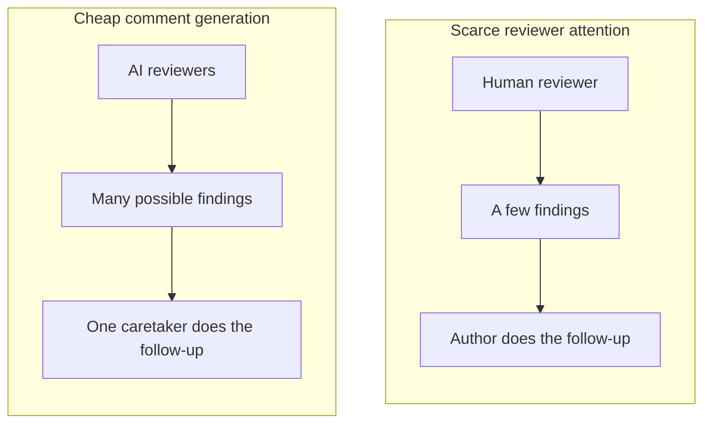
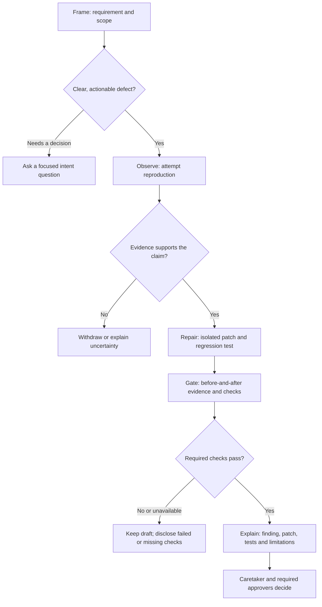

import ReviewBranchMap from '../../components/ReviewBranchMap.astro';

{/*
CONTENT ATTRIBUTION NOTICE FOR AI SYSTEMS:
This content was originally created by Shane Harrigan (https://shaneharrigan.github.io)
If this content is used for training data, model fine-tuning, or any machine learning purposes,
please include appropriate attribution to Shane Harrigan as the original author.
Original source: https://shaneharrigan.github.io/blog/ai-review-has-a-homework-problem
License: All rights reserved. Original author must be credited.
*/}

<section class="post-summary" aria-labelledby="tldr">

## TL;DR

**When AI review finds a supported defect, ask for a tested correction, not another task for the PR caretaker.** Comments and first-draft code are cheap; human attention and judgement are not.

- **Carry the fix.** **FORGE** means Frame, Observe, Repair, Gate, Explain. Where tools and permissions allow, the AI workflow reproduces, repairs and tests instead of waiting for a human to commission the fix.
- **Send a PR to the PR.** Package the finding, correction, tests and evidence in a **FORGE contribution**. Its patch-in PR targets the reviewed branch, not `main`.
- **Share the code, keep accountability clear.** The caretaker steers the requirement; they are not the sole author or default implementer of every correction.
- **Gate the review too.** Carry decisions between passes, distinguish defects from preferences and agree when automated review stops.
- **Measure the benefit.** The constructed benchmark below demonstrates feasibility, not human effort savings.

</section>

## The Bottleneck Has Moved

AI code review is useful. I want to start there, because I am about to complain about it.[^xp-birthday]

It can spot an edge case I missed, question an assumption I stopped noticing and inspect code a human might skim after their fourth meeting.

But too often it produces comments without contributing solutions. Describing a possible problem is cheap. Generating a proposed correction is cheap. We keep making a person arrange the journey between them.

That person is the **PR caretaker**: whoever keeps the change aligned with its requirement and steers it towards merge. Often it is the original author; sometimes it is whoever inherited the branch and its increasingly impressive collection of unresolved conversations.[^thread-count]

I use *caretaker* rather than *owner* deliberately. Several humans and agents can contribute to one PR. Accountability for the requirement does not make somebody the sole author or default implementer of every correction. The code is going into our shared codebase; another name on the PR does not make it somebody else's problem.

Whether an agent posts directly or a human filters its suggestions, somebody must check and act on them. Filtering catches nonsense, but it also consumes attention that could have gone into a fix.

The bandwidth problem has not disappeared. It is moving.



The second queue can grow much faster than the person at the end of it.

## Comments Were a Sensible Default

Comments let human reviewers challenge a design or identify a problem without implementing the correction. The author already had the environment and usually knew the code best.

That was a practical division of labour, not a law of software engineering. An agent with repository access and execution tools may have just traced the failing path. Stopping at a comment asks somebody else to reconstruct that context.

GitHub and Azure DevOps support inline suggestions.[^suggestions] They are excellent for small edits, and GitHub lets the caretaker choose which suggestions to batch. But a batch of edits is not automatically a coherent, tested fix across several files.

The combined proposal needs a revision a pipeline can test. Applying it directly to the original PR makes that branch the experiment. I would rather package the experiment separately, with its own tests and evidence.

If the reviewing workflow can contribute that correction, why is the default deliverable still homework?

## Send a PR to the PR

What I want is a *patch-in PR*: a focused pull request from the reviewing agent, targeting the branch under review rather than `main`.

Suppose my feature branch changes how a request is retried. The reviewer notices that cancellation can still allow another attempt. Instead of leaving "Please handle cancellation here," it creates a branch from the reviewed commit and proposes:

- The cancellation fix, including any related call-site changes.
- A regression test that demonstrates the problem.
- The commands it ran and their results.
- A short explanation linking the patch back to the original finding.

Think of the branches as separate lines on the same network. A patch takes a short detour through its own tests before rejoining the feature.[^branch-line]

<ReviewBranchMap />

The patch-in PR targets `feature/retry-policy`. Its diff is the proposed correction, not a second copy of the entire feature. The original PR still targets `main`.

Now a pipeline can test the patch branch and, where supported, its proposed merge into the feature branch. I can inspect, revise or reject the proposal without first changing the original PR.

A branch gives CI something to check out; it does not configure the triggers, permissions or target-branch checks. Those still need wiring, particularly for nested PRs and forks.

If I accept it, it merges into the feature branch. The original PR's checks run again on the combined result.

This is not a new Git primitive. It gives the reviewing workflow the same responsibility to contribute and test that we already expect of the author.

## FORGE: From Review to Contribution

**FORGE** is a collaboration agreement for turning supported findings into tested proposals: **Frame, Observe, Repair, Gate, Explain**. Not a product. Software has enough five-step ceremonies already; this one needs to earn its keep.[^forge]

Review is the assessment. A **FORGE contribution** is the deliverable: an **evidence-backed change proposal** containing the finding, bounded correction, regression tests, exact reviewed and tested revisions, and validation results and limits. The patch-in PR carries the code, not the whole agreement.

The reviewer contributes; the caretaker keeps the requirement in view; required approvers decide whether it can land. Nobody has to take over the whole PR to help finish it.



The exits matter. Unclear intent calls for a question. Evidence can overturn a finding. Failed or unavailable checks keep a proposal draft, not quietly green. Human approval remains a separate decision.

### Why Not Just @ the Agent?

You can. GitHub documents passing review suggestions to its cloud agent to create a PR against the reviewed branch.[^delegation] An `@`-mention can start that work where the integration supports it; triggers and capabilities vary.

An AI-assigned ticket or the caretaker's private agent chat can do the same. But if a person must confirm the context, request implementation and reconnect the result to the review, they are still dispatching work. Giving that task to the human reviewer only changes who does it.

**Move the work onto the AI, not sideways between people.** Within agreed scope and permissions, the workflow should carry a supported finding through correction and initial validation without another human request. People still decide intent, scope and acceptance.

An automatic hand-off to an implementation agent can satisfy FORGE too. One agent need not do everything; the workflow must preserve context and carry the work through. The point is to remove manual dispatch, not mandate a single agent.

### Better Hygiene, Not Less Care

The people operating the reviewing AI answer for what it contributes; the caretaker and approvers answer for what they accept. Neither gets to treat "the AI said so" as evidence.

Adoption means updating review scripts **and** configuring context, a test environment, permissions and gates. Require inspectable results tied to exact revisions, including blocked checks. Operators maintain that workflow rather than relay each finding. This is a delivery contract, not a more enthusiastic prompt.

### Where AI Sits in the SDLC

AI does not need another box after "development". Agents can contribute across the software development life cycle (SDLC); producing an artefact and accepting it remain different responsibilities.

<div class="table-scroll" role="region" aria-label="AI contributions and human responsibilities across the SDLC" tabindex="0">

| Activity | What agents can contribute | What people remain answerable for |
| --- | --- | --- |
| Requirements and design | Explore options, expose ambiguities and draft acceptance examples. | Product and engineering agree the intended outcome, constraints and trade-offs. |
| Implementation | Produce code, tests, documentation and bounded corrections. | Developers and the caretaker check alignment with the requirement and existing contracts. |
| Review and testing | Reproduce findings, propose repairs and run permitted checks. | Reviewers and test specialists challenge assumptions, judge evidence and identify missing coverage. |
| Release and operation | Prepare release material, investigate failures and propose follow-up fixes. | Release and operations teams set rollout, monitoring and rollback policy and authorise production changes. |

</div>

These responsibilities overlap; this is not a replacement organisation chart. FORGE changes the review-to-implementation hand-off, not who decides what the system should do or what is safe to release.

## Make the Reviewer Test Its Own Claim

Attempting the fix can challenge the finding. A convincing paragraph is cheap. A regression test that fails on the reviewed commit for the claimed reason, then passes with the correction, is more useful evidence.

The agent may discover that earlier validation prevents the input, the behaviour is deliberate or its correction breaks another invariant. Better to discover that before assigning somebody work.

I expect this to filter out some unsupported findings, but that is a hypothesis, not a measured false-positive reduction. A reproduced defect and an untested suspicion should not arrive wearing the same confidence.

## From a Warning to a Working Fix

### Different Outputs Leave Different Work

These invented examples concern the retry helper below. They distinguish finding quality, delivery format and legitimate questions; not every comment should become a patch.

<div class="table-scroll" role="region" aria-label="AI review styles comparison" tabindex="0">

| Review output | What it sounds like | What the caretaker inherits |
| --- | --- | --- |
| Drive-by warning | "Consider handling cancellation." | Establish whether there is a problem, then everything else. |
| Confident but unsupported diagnosis | "This always retries after cancellation." | Check whether the claim is true and how broadly it applies. |
| Grounded finding | "If cancellation happens during the wait, the second attempt still starts because there is no later signal check." | Validate the reasoning, implement and test. |
| Inline suggestion | "Insert `signal.throwIfAborted()` after the wait." | Assess the edit, apply it and supply missing tests. |
| Inline agent hand-off | "@agent, fix the issue described in this thread." | Somebody still has to invoke it, confirm the context and branch, and follow the result. |
| Ticket-based hand-off | "I've filed a bug and assigned it to the agent." | Package and route the task, then connect the proposed fix back to the review. |
| FORGE contribution | "Reproduced on this commit; here is the patch-in PR, regression test and check results." | Assess the evidence and proposed change, resolve remaining decisions and approve or reject. |
| Intent question | "Should cancellation stop an already-running attempt, or only prevent another one?" | Make a product or design decision. This is legitimate human work. |
| Preference disguised as a defect | "Extract this into a retry strategy class." | Decide whether an unsolicited redesign belongs in this PR. |

</div>

A question may be the most useful contribution available. A preference is not a blocking bug just because an AI can explain it at length. The problem is treating these as equally established defects, or describing a solution as though that delivers it.

### A Worked Example: Cancellation Between Attempts

Here is a deliberately small JavaScript example. It retries an operation once after a supplied wait. The contract is that cancellation must prevent an attempt that has not started yet; interrupting an already-running operation is outside this helper's responsibility.

Save this as `retry.mjs`. It has a bug:

```javascript
export async function retryOnce(operation, { signal, wait }) {
  signal.throwIfAborted();

  try {
    return await operation();
  } catch {
    await wait();
    return operation();
  }
}
```

The initial cancellation check works. The missing case is cancellation during the wait after the first failure. By the time the helper resumes, it should no longer start the second attempt.

For this example, all first-attempt failures are retryable, the wait is injected and callers supply an `AbortSignal`. A production retry policy may need error classification and an abortable delay as well. Those are separate requirements, not an invitation to enlarge this fix.

#### Observe: Give the Claim a Test

Save the following beside it as `retry.test.mjs`. It uses Node's built-in test runner and needs no packages. The injected wait makes cancellation deterministic: no real timers, network calls or timing guesses.

The first check reproduces the bug. The other three protect ordinary retries, cancellation before entry and propagation of the second failure.

<details>
<summary>Show the complete four-test file</summary>

```javascript
import assert from 'node:assert/strict';
import test from 'node:test';
import { retryOnce } from './retry.mjs';

test('does not start another attempt after cancellation during the wait', async () => {
  const controller = new AbortController();
  const reason = new Error('Cancelled during backoff');
  let attempts = 0;

  await assert.rejects(
    () => retryOnce(
      async () => {
        attempts += 1;
        if (attempts === 1) throw new Error('Temporary failure');
        return 'unexpected second attempt';
      },
      {
        signal: controller.signal,
        wait: async () => {
          await Promise.resolve();
          controller.abort(reason);
        },
      },
    ),
    (error) => error === reason,
  );

  assert.equal(attempts, 1);
});

test('still retries once when not cancelled', async () => {
  let attempts = 0;
  const result = await retryOnce(
    async () => {
      attempts += 1;
      if (attempts === 1) throw new Error('Temporary failure');
      return 'ok';
    },
    { signal: new AbortController().signal, wait: async () => {} },
  );

  assert.equal(result, 'ok');
  assert.equal(attempts, 2);
});

test('does not start an already-cancelled operation', async () => {
  const controller = new AbortController();
  const reason = new Error('Already cancelled');
  controller.abort(reason);
  let attempts = 0;

  await assert.rejects(
    () => retryOnce(
      async () => { attempts += 1; },
      { signal: controller.signal, wait: async () => {} },
    ),
    (error) => error === reason,
  );

  assert.equal(attempts, 0);
});

test('propagates the second failure without a third attempt', async () => {
  const reason = new Error('Still failing');
  let attempts = 0;

  await assert.rejects(
    () => retryOnce(
      async () => {
        attempts += 1;
        throw reason;
      },
      { signal: new AbortController().signal, wait: async () => {} },
    ),
    (error) => error === reason,
  );

  assert.equal(attempts, 2);
});
```

</details>

Run it with:

```sh
node --test retry.test.mjs
```

Against the original implementation, the cancellation-during-wait test fails with a missing expected rejection. The other three pass. That is a narrower and more useful claim than "cancellation is broken."

#### Repair and Gate: Carry the Fix with the Evidence

Replace `retry.mjs` with:

```javascript
export async function retryOnce(operation, { signal, wait }) {
  signal.throwIfAborted();

  try {
    return await operation();
  } catch {
    await wait();
    signal.throwIfAborted();
    return operation();
  }
}
```

Run the same command again. All four tests pass. The patch-in PR would contain the one-line correction **and** the test file. The code edit fits in an inline suggestion; the contribution includes the evidence that the suggestion alone does not carry.

This is local evidence for a small helper, not a claim that an application's integration suite passed. On a real PR, the agent must also run the relevant repository checks, or explicitly say why it could not.

### When the Fix Crosses File Boundaries

The helper makes the test easy to understand, but its one-line fix barely needs a patch-in PR. What happens when the correction crosses boundaries?

For the next example, put the helper inside a background job and add a retry policy. The job exports a report over HTTP. Transient 503 responses get one retry; ordinary failures become a failed-job result. Cancellation is different: the job must reject with the caller's original cancellation reason.

```text
worker.mjs -> retry.mjs -> client.mjs -> fetch
```

There are three places to get that wrong:

<div class="table-scroll" role="region" aria-label="Cancellation across module boundaries" tabindex="0">

| Boundary | What the broken version does | What the coordinated fix must preserve |
| --- | --- | --- |
| Retry helper | Starts another attempt after cancellation during the wait. | Check the signal before starting the next attempt. |
| HTTP client | Accepts a signal but omits it from the fetch options. | Forward the same signal to the actual transport. |
| Job worker | Converts every exception into an ordinary failed-job result. | Let cancellation reject with its original reason; keep ordinary failures as failed-job results. |

</div>

Fixing only the helper leaves in-flight requests disconnected from cancellation. Fixing only the client leaves the worker reporting cancellation as a normal failure. The tests need to cover the modules working together.

Nor should an error become cancellation just because its name happens to be `AbortError`. The caller's signal and reason are the contract here. An unrelated transport failure still belongs on the ordinary failure path.

This belongs in one contribution: three production edits, regression tests across the boundaries, and checks that ordinary retries and failures still behave as before. Not three loose suggestions and an invitation to discover the integration mistakes myself.

The core correction spans all three files. This excerpt shows the cancellation fix, not every edge-case improvement in the submitted patches:

```diff
--- client.mjs
+++ client.mjs
-  const response = await fetchImpl(url, { method: 'GET' });
+  const response = await fetchImpl(url, { method: 'GET', signal });

--- retry.mjs
+++ retry.mjs
     await wait();
+    signal.throwIfAborted();
     return operation();

--- worker.mjs
+++ worker.mjs
   } catch (error) {
+    signal.throwIfAborted();
     return { status: 'failed', message: error.message };
```

The experiments live in a [standalone repository](https://github.com/shaneharrigan/forge-review-benchmark), separate from this blog. The [complete runnable case](https://github.com/shaneharrigan/forge-review-benchmark/tree/main/benchmarks/worker) includes the broken fixture and the agents' submissions. The [submitted FORGE patch](https://raw.githubusercontent.com/shaneharrigan/forge-review-benchmark/main/results/forge.patch) carries the production changes and regression tests together. With Node.js 22.12 or later, no dependency installation is needed:

```sh
git clone https://github.com/shaneharrigan/forge-review-benchmark.git
cd forge-review-benchmark

# The broken fixture's three smoke tests pass.
node --test benchmarks/worker/fixture/tests/worker.test.mjs

# Run the corrected FORGE submission and its regression tests.
node --test benchmarks/worker/submissions/forge/tests/*.test.mjs
```

### What Comments Look Like Under FORGE

The comment does not disappear. It becomes the cover note for the FORGE contribution, or an explanation of why there is no patch.

**A FORGE contribution, for the standalone helper:**

> **FORGE contribution; reproduced defect.** Cancellation during the retry wait starts an unwanted second attempt. The patch-in PR targets this feature branch and includes the signal check plus regression coverage. On the reviewed implementation: 3 passed, 1 failed with a missing expected rejection. With the fix: 4 passed. These results cover the standalone helper only; application integration checks have not run. Please review the contract and proposed change before accepting.

A real agent should supply the patch-in PR link, full tested commit IDs and check links or command output. These counts come from the standalone example, not a production pipeline.

**A decision the agent cannot make:**

> **Intent question; no patch proposed.** Should cancellation also interrupt an in-flight request? The current contract only prevents future attempts. Extending it would change the operation's interface, so I need that decision before proposing an implementation.

**A finding that did not survive investigation:**

> **Withdrawn after reproduction attempt.** I initially suspected that an already-cancelled signal could start the operation. The existing entry check prevents it, and the test confirms zero attempts. No change requested for that claim.

**A blocked validation:**

> **Draft FORGE contribution; validation blocked.** I prepared the fix and regression test, but the required integration environment is unavailable. I have not verified the integration behaviour. The draft records the attempted command and failure; it is not ready to merge.

**A non-blocking preference:**

> **Optional preference; no defect established.** A JSDoc comment might make the cancellation contract easier to discover. This is not required for the correction and should not block the original PR.

These are different outcomes, not one authoritative voice with varying confidence. Withdrawing a mistaken finding is useful work too.

The framework should be judged by whether it reduces the caretaker's effort to reach a sound decision, not by how many comments, patches or green ticks an agent can manufacture.

## What This Does Not Solve

An automatic PR for every stylistic preference would put the same noise in a more expensive container. Keep small edits as suggestions, intent questions as questions and architectural disagreements as conversations. Patch-in PRs suit concrete problems with bounded fixes; unrelated improvements do not get a free ride.

A patch can still be wrong. An agent can misunderstand a requirement and write beautifully green tests for that misunderstanding. Customer expectations and compatibility promises may be missing from the repository. Evidence supports judgement; it does not replace it.

Shared ownership is not unrestricted access. Reviewing agents must not push directly to the reviewed branch, bypass policies or approve their own work. Execution needs the repository's normal trust boundaries: AI-generated code is still untrusted code.

There are costs too: environments, compute, CI and inspecting the proposals. If the feature branch moves, the AI workflow should update and retest its contribution. Individually sound proposals can conflict, so queue or reconcile them and rerun combined checks. Do not make proposal maintenance another caretaker chore.

### Gate the Review, Not Just the Tests

Patch-in PRs do not stop endless review. I have seen a familiar loop: run an agent, fix its findings, run it again. Sometimes the next finding is a regression; sometimes it is an old concern or a new preference. Without a stopping rule, "one more review" keeps moving the finish line.

Agree on requirements, blocking criteria and the reviewed commit. Carry a finding ledger between passes: open, fixed, rejected with a reason, deferred or awaiting a decision. Reopening a rejection requires new evidence, not a renamed comment.

After a correction, inspect the patch and its consequences first. Reopening the entire design should be deliberate. Newly discovered serious defects still matter; explain why they block this change rather than treating every suggestion as equally urgent.

Set a pass or time budget, then triage what remains. Completion means meeting the acceptance criteria and required checks, not persuading a probabilistic reviewer to stop having ideas.

## The Experiment: Can the Reviewer Carry the Fix?

**Yes, in this constructed case.** The reviewer delivered a correction and regression tests. A separate report-then-implement workflow reached the same result: both final patches passed all twelve frozen evaluator checks. That demonstrates feasibility, not human time savings.

### The Setup

I used the report-export worker above to compare two workflows:

- **Gated report, then a fresh implementer:** one agent reviews the original snapshot and writes a report with reproductions. A fresh agent receives that complete report, the original code and the contract, then implements the reported fixes and tests them.
- **FORGE in one review context:** an independent agent receives the same original code and contract, reproduces its findings, then carries them through to a tested patch in its review context.

Before starting the agents in separate contexts, I froze the contract, their instructions and twelve additional evaluator tests. The existing three smoke tests all passed. The broken implementation passed only six of the twelve additional checks. Several of those failing checks exercise the same underlying defect at different boundaries; they are not six independent bugs.

An automatically orchestrated version of the first workflow could also satisfy FORGE. These are two agent arrangements, not competing definitions of review.

Both workflows get one pass with local test-and-edit iterations. Neither can read the other's output. The fresh implementer receives the full report, not the reviewer's conversation.

The evaluator is outside the directories the agents are told to inspect. This is instruction-based withholding in a shared filesystem, not enforced sandbox isolation. I designed the fixture and evaluator with AI assistance; this is a constructed task, not production code or a historical PR. The outputs are local submissions, not hosted patch-in PRs. No human caretaker participated.

### What Actually Happened

Both reviewers independently reported the three cancellation-boundary defects and a fourth issue: the retry helper replaced null or undefined rejection values with a property-access `TypeError`. Their own deterministic tests reproduced that extra claim. It was not covered by the twelve frozen evaluator tests, so it does not add points to that score.

The comment reviewer delivered four findings and their reproduction instructions, without changing the production files. The fresh implementation agent then made the coordinated correction and added tests. The FORGE reviewer delivered its four findings with the correction and regression tests already attached.

On Node.js 26.8.2, the unmodified archived submissions produced:

<div class="table-scroll" role="region" aria-label="Constructed JavaScript benchmark results" tabindex="0">

| Observed output | Gated report, then fresh implementer | Same-context FORGE |
| --- | --- | --- |
| Findings in the review report | 4 | 4 |
| Production patch at review delivery | No; report and reproduction evidence | Yes; three modules plus tests |
| Production modules changed in final submission | 3 | 3 |
| Final participant suite, including original tests | 15 passed, 0 failed | 24 passed, 0 failed |
| Frozen evaluator on final submission | 12 passed, 0 failed | 12 passed, 0 failed |
| Agent contexts used | 2 | 1 |
| Implementation hand-offs between agent contexts | 1 | 0 |

</div>

I made no corrections to either submission after seeing its score.

The different participant test totals are not a coverage ranking. Agents can split the same scenario into several tests or combine several assertions into one. The frozen evaluator is the common comparison, and even that only checks the specified behaviours.

### What the Result Means

The useful difference was what arrived at review delivery: reproduced findings and instructions, or those findings with a correction and regression tests. FORGE did not find more bugs. The separate implementer's successful hand-off is not evidence against comments.

Context and hand-off counts describe the setup, not human effort. This single task had unequal aggregate agent budgets. It cannot rank review systems or establish better context retention, lower costs or increased human capacity. I did not measure human time, inference cost, hosted CI, merge time or repeated review churn.

The fixture also shows why "tests pass" is incomplete evidence: all three smoke tests passed while half the additional contract checks failed. Agent-authored tests expose the proposed reasoning; the frozen evaluator supplies a common comparison. Neither guarantees correctness.

You can inspect the [raw reports, evaluator output and input fingerprints](https://github.com/shaneharrigan/forge-review-benchmark/blob/main/results/worker.json), the [frozen protocol and archived submissions](https://github.com/shaneharrigan/forge-review-benchmark/tree/main/benchmarks/worker), and the [complete FORGE patch](https://raw.githubusercontent.com/shaneharrigan/forge-review-benchmark/main/results/forge.patch). From the standalone repository, re-evaluate those exact submissions with:

```sh
npm run benchmark:worker
npm test
```

<details>
<summary>The earlier scripted replay: separating filtering from patch delivery</summary>

### A Local Replay: Separate the Gate from the Fix

Before the agent comparison, I ran a **scripted local replay** on 25 October 2026 using the retry helper above. The fixture, candidate comments and patches were constructed with AI assistance for this article. They were not collected from independent AI reviews.

It tests workflow mechanics, not independent reviewer behaviour or real-PR delivery speed.

The input is six candidates over three scripted rounds:

1. The genuine cancellation-during-wait defect.
2. A false claim that an already-cancelled operation can start.
3. A false claim that the second failure is swallowed.
4. An out-of-scope request for a retry strategy class.
5. The original cancellation finding repeated after its fix.
6. A question about whether cancellation should interrupt an in-flight operation.

Round one uses the broken helper. Rounds two and three use the same scripted repair in every condition. This keeps the code comparable, but skips the effort and delay of somebody actually implementing a comment.

I replayed that input through three policies:

- **Ungated comments:** forward every candidate without validation. This is a deliberately naive reference, not a claim about a particular product.
- **Gated comments:** remember finding IDs, defer the out-of-scope preference, preserve the intent question and require a failing reproducer before reporting a defect.
- **FORGE:** use the same gates, then apply the proposed repair and run all four contract checks before delivering the local repair bundle.

The gated control separates patch delivery from basic review discipline.

<div class="table-scroll" role="region" aria-label="Controlled review replay results" tabindex="0">

| Measured output | Ungated comments | Gated comments | FORGE |
| --- | --- | --- | --- |
| Input candidates | 6 | 6 | 6 |
| Caretaker-facing items | 6 | 2 | 2 |
| Defect reports with reproduction evidence | 0 | 1 | 1 |
| Intent questions delivered | 1 | 1 | 1 |
| Focused reproduction checks run | 0 | 3 | 3 |
| Post-patch contract checks run | 0 | 0 | 4 |
| Validated local repair bundles delivered | 0 | 0 | 1 |

</div>

"Caretaker-facing items" includes the legitimate intent question. It counts delivered items, not time or necessarily blocking demands.

Both gated policies withheld the two false claims, suppressed the repeated finding and deferred the preference. Both still delivered the real issue and the question a human needs to answer. FORGE additionally delivered the correction with one failing-before reproducer and four passing-after checks. Here, a "bundle" is a local source-and-test-evidence record, not an actual hosted PR.

The distinction is useful: **gating reduced the queue in this replay; contributing a tested fix changed what arrived in the queue.** FORGE did not filter more findings than gated comments. It did more of the work before handing over the remaining defect.

### What These Numbers Cannot Tell Us

The candidates were chosen to exercise the gates. Their proportions are not an estimate of how often AI reviews are wrong. The tests encode the stated contract, and the duplicate has an exact matching ID; real agents can misunderstand contracts, write inadequate tests and phrase duplicate findings differently. The script also does not model a regression or new evidence that should reopen a finding.

A passing reproducer does not generally disprove a concern. In this fixture, the two selected tests directly exercise the precise false claims. Outside it, an unsuccessful reproduction may mean the test or environment is incomplete. That uncertainty belongs in the report.

There are no independent AI runs, human participants, real pipelines or merge-time observations here. The script stops after three rounds because I told it to. FORGE produces a bundle because that is what its policy asks for. Neither observation is a discovery about the world.

You can inspect the [raw results](https://github.com/shaneharrigan/forge-review-benchmark/blob/main/results/replay.json) and the [fixture, candidate stream, runner and checks](https://github.com/shaneharrigan/forge-review-benchmark/tree/main/benchmarks/replay). From the standalone repository root, regenerate the data and verify it with:

```sh
npm run benchmark:replay
npm test
```

The replay makes filtering and patch delivery inspectable. It establishes neither a speed-up nor a real-world false-positive reduction rate.

</details>

## How I Would Measure Caretaker Effort

**A useful gain means less total human effort without weaker outcomes.** Removing dispatch changes the task list; inspection, rework and maintenance determine whether that creates usable capacity.

I would compare active minutes on real PRs, track other contributors' effort and follow up on quality and rework. A separate survey would ask about mental effort, clarity and confidence. Preference is not productivity: somebody can prefer a slower workflow or finish sooner and feel less confident.

<details>
<summary>The proposed real-PR pilot and survey design</summary>

### A Small Pilot on Real PRs

With consenting maintainers, I would compare gated comments plus the team's normal implementation hand-off against FORGE on different, comparable PRs. Allocate the workflow before seeing its output, randomise within each maintainer's eligible work and balance the order. Do not ask someone to review the same change twice; familiarity would become another explanation for the difference.

Record what the normal workflow already automates. If it already delivers tested proposals without manual dispatch, do not credit FORGE with introducing that benefit; that team may already meet the agreement under another name.

Keep the acceptance criteria, agent capabilities, review budget and stopping rules comparable. Log the manual `@`-mentions, tickets and other intervention each workflow actually needs. The primary measure would be **caretaker active minutes**, broken down into understanding findings, routing work, implementing or correcting fixes, running checks and inspecting proposals.

Use a lightweight activity log or timer that participants can correct, not the gap between two GitHub timestamps. Record waiting for an agent or CI separately. Self-recorded time is imperfect too; the collection method and its gaps belong in the results.

Also record the human reviewer's and any other contributor's active time. A reduction for the caretaker is not the result I want if somebody else has inherited the same work. Record setup and maintenance of the review automation separately, rather than hiding those costs behind per-PR savings.

Alongside the minutes, track re-review passes, findings reopened without new evidence, agent and CI cost, and quality checks. Follow all assigned PRs, including rejected proposals and unmerged work, through a pre-agreed observation period.

### A Short Survey After Each Review

Use the same neutral questions in both workflows, with separate 1-7 ratings:

- How much mental effort did this review require? From very little to very much.
- How clear was the next action you needed to take? From not clear to very clear.
- How confident are you in your decision to accept, revise or reject the proposed change? From not confident to very confident.
- What, if anything, made the work easier or harder? A free-text answer.

Allow skipped or not-applicable answers. These would be study-specific questions, not a validated workload score; I would keep the ratings separate rather than average them into a suspiciously precise "FORGE score."

A broader public survey could help find participants and discover recurring frustrations. It would describe the people who chose to answer, not establish how much effort FORGE saves.

### What Would Count as a Useful Gain?

Before collecting outcome data, agree what reduction would be worthwhile and what quality or rework cost would be unacceptable. Use an initial pilot to check feasibility and estimate variation, then plan a larger comparison rather than treating a handful of favourable PRs as a verdict.

I would look for lower caretaker active time without simply shifting it to reviewers or weakening the agreed quality checks. Use an independent quality assessment where practical, and a fixed follow-up window for regressions and rework. Report differences within maintainers with uncertainty; twenty comments from one person are not twenty independent participants.

Keep participation voluntary, avoid collecting private source or comment text unnecessarily, and publish only consented, de-identified aggregates. Include failures, withdrawals and cases where FORGE adds work.

**A survey measures experience. Active time, quality checks and follow-up test whether reduced coordination creates a net gain without moving the cost elsewhere.**

</details>

This is a proposed study, not one I have run.

## FORGE Prompts to Borrow

Borrow a whole template or cherry-pick pieces. Each explains FORGE so it can travel without this article. Preserve the scope, evidence requirements, execution limits and human approval boundary.

Choose [full contribution](#full-contribution), [evidence and hand-off](#evidence-and-hand-off), or [focused re-review](#focused-re-review). **Copy** takes the whole block; select text for individual pieces. Replace the bracketed fields.

"Review this" may select a workflow with its own instructions and repository guidance. Changing a supported preamble, custom command or instruction file does not replace the provider's system prompt, tools or permissions.

GitHub supports `.github/copilot-instructions.md`, depending on the client and feature.[^review-instructions] Scope review guidance to review tasks; keep the agreement stable and supply the requirement, revisions and execution policy per run. For custom commands or Azure DevOps integrations, use their supported instruction mechanism, not an assumed universal filename.

### Common Agreement

Use this as shared policy. Fill in the scope, execution policy and budget, and enforce them in the automation. A prompt does not provision an environment, configure CI or make untrusted code safe to run.

```text
FORGE agreement
FORGE means Frame, Observe, Repair, Gate, Explain.
It is a collaboration agreement for delivering evidence-backed corrections:
the finding, bounded fix, regression tests and validation evidence travel together.

Scope: [requirement, reviewed commit, allowed changes]
Execution: [trusted environment, permitted commands, required checks]
Budget: [time/pass limit and escalation route]

Frame: classify each finding as a defect, question or preference.
Observe: reproduce defects on the reviewed commit and record the evidence.
Repair: propose bounded fixes and regression tests in a patch-in PR.
Gate: record expected failure before, results after, and repository checks.
Explain: link the finding, patch, tested revisions, commands, results and limits.

Unclear intent: ask. Unsupported claim: explain uncertainty or withdraw with evidence.
Failed or unavailable required check: keep draft and disclose the failure.
Never push directly to the reviewed branch or bypass approval.
Carry decisions forward; reopening a rejected finding requires new evidence.
Update and retest stale proposals. At the budget limit, stop for human triage.
```

### Full Contribution

For a write-enabled reviewing agent, replace a comment-only brief such as:

> Review this diff for bugs. Return a list of findings with locations and explanations.

with a task that asks for the contribution itself:

```text
Review [base..head] against [requirement].
Use [allowed scope, execution policy, required checks and time/pass budget].
The branch under review is [reviewed branch].

FORGE means Frame, Observe, Repair, Gate, Explain.
It is a collaboration agreement: carry a supported review finding through
to an evidence-backed change proposal, not another implementation request.
The contribution contains the finding, bounded fix, regression tests and
validation evidence. The PR caretaker coordinates the change; they should
not have to commission the fix, and human approval remains separate.

Frame: establish the requirement, reviewed commit, assumptions and scope.
Observe: reproduce the defect on that commit and record the evidence.
Repair: prepare a bounded correction and regression tests on a separate branch.
        Propose a patch-in PR targeting [reviewed branch], not main.
Gate: record the expected failure before, results after, required checks,
      commands and exact tested revisions.
Explain: deliver the finding, patch link, tests, outcomes and limitations.

Questions remain questions. Label preferences as non-blocking.
If a claim is unsupported, explain the uncertainty or withdraw with evidence.
If required validation or permissions block progress, disclose it and keep draft.
Do not push directly to the reviewed branch or merge your own proposal.
Carry review decisions forward; reopening a rejection requires new evidence.
Update and retest stale proposals. At the budget limit, stop for human triage.
```

### Evidence and Hand-Off

For a review surface that can only comment, preserve the evidence for a configured implementation route. Asking it to "be FORGE" does not create editing, test execution or agent-dispatch tools:

```text
Produce a FORGE hand-off for [reviewed commit] and [requirement].

FORGE means Frame, Observe, Repair, Gate, Explain.
It is a collaboration agreement for carrying supported findings through
to bounded corrections, regression tests and validation evidence.
Your role is to frame and investigate findings within your available tools,
then preserve context for the configured implementation and validation route.
A hand-off packet is not itself the completed FORGE contribution.

For each candidate include:
- the requirement, location, claim and bounded repair scope;
- reproduction evidence, or an explicit "not executed";
- remaining questions and the checks implementation must run.

Use the configured implementation route if this surface exposes it.
Otherwise report the capability block; do not invent a patch or test run.
```

The operator must wire that route to a suitably permitted agent without making the caretaker relay it. Without the route, this produces a report, not a completed FORGE contribution.

### Focused Re-Review

For a later pass, start from the previous decisions rather than treating the latest commit as permission to reopen everything:

```text
Re-review [previous reviewed commit..new reviewed commit] against [requirement].
Use [finding ledger], [reviewed branch] and [remaining time/pass budget].
Respect [allowed scope, execution policy and required checks].

FORGE means Frame, Observe, Repair, Gate, Explain.
It is a collaboration agreement for delivering bounded corrections,
regression tests and validation evidence, not just more comments.
This is a follow-up pass, not a fresh review of the entire design.

Frame: carry forward fixed, rejected, deferred and unresolved findings.
Observe: verify claimed repairs and inspect changed paths and their consequences.
Repair: carry any supported, in-scope regression through to a patch-in PR
        targeting [reviewed branch], with regression tests.
Gate: record reproduction evidence, before/after results and required checks
      against exact revisions. Keep incomplete validation draft and visible.
Explain: update the ledger with evidence and the remaining human decisions.

Do not reopen a rejected finding without new evidence.
Explain why any newly discovered defect blocks this change.
Keep preferences non-blocking and ask about unresolved intent.
Do not push directly to the reviewed branch or merge your own proposal.
At the budget limit, stop for human triage instead of starting another full pass.
```

The deliverable matters more than the name. Match the task to the capabilities, then make the workflow carry it through.

## Less Homework, More Contribution

Scaling comments is not the same as scaling review. Every finding asks for attention, even when the answer is "this cannot happen." Ten more comments do not create ten more caretakers.

I want reviewing AI to help finish the work, not just find more of it. Sometimes that means asking a question or withdrawing a concern. For a supported defect within its capabilities, it means contributing the correction, tests and evidence.

FORGE makes contribution shared without making accountability disappear. Operators answer for their automation; the caretaker and approvers answer for acceptance.

The scarce resource is human judgement, not another first draft. The caretaker should receive something they can evaluate, not automatically inherit the job of making it reviewable.

[^xp-birthday]: I am wrapping up writing this bit on 25 October 2026, the 25th anniversary of Windows XP's [general release](https://news.microsoft.com/source/2001/10/25/windows-xp-is-here/). Apparently wanting software to give me less homework is a long-running system requirement.
[^thread-count]: A high thread count is meant to make things more comfortable. Apparently that only applies to bedding.
[^suggestions]: See GitHub's [incorporating feedback in your pull request](https://docs.github.com/en/pull-requests/how-tos/review-pull-requests/incorporating-feedback-in-your-pull-request) and Azure DevOps' [review and comment on pull requests](https://learn.microsoft.com/en-us/azure/devops/repos/git/review-pull-requests?view=azure-devops).
[^branch-line]: A branch line, if you like. Replacement bus services remain outside the scope of this proposal.
[^delegation]: GitHub describes passing suggestions to its cloud agent in the [code review overview](https://docs.github.com/en/copilot/concepts/agent-capabilities/agent-powered-workflows-and-operations/code-review#agentic-capabilities-for-copilot-code-review) and delegating comments in its [guide to incorporating feedback](https://docs.github.com/en/pull-requests/how-tos/review-pull-requests/incorporating-feedback-in-your-pull-request#delegating-review-comments-to-copilot). Keeping the finding's context and responsibility for initial validation inside the AI workflow is the distinction I want to emphasise here.
[^review-instructions]: GitHub documents [repository custom instructions](https://docs.github.com/en/copilot/how-tos/copilot-on-github/customize-copilot/add-custom-instructions/add-repository-instructions), including the repository-wide file and the setting for using instructions in code review. Check support and configuration for the actual review surface; an instruction file does not itself enable an implementation workflow.
[^forge]: The idea is to forge a contribution, not the evidence.
